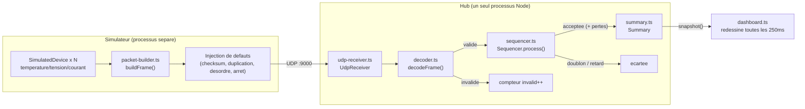

# PulseHub

Dépôt GitHub : https://github.com/abdulrahman-adam/PulseHub

Hub central de télémétrie temps réel pour une flotte d'équipements événementiels (alimentations, contrôleurs LED, amplis) qui envoient leur état (température, tension, courant) en UDP, selon le protocole **PulseHub v1**.

## 1. Démarrage local

**Prérequis :** Node.js 18+ (développé et testé avec Node v24.12.0 / npm 9.8.0), aucune autre dépendance système.

```bash
npm install
```

Trois terminaux séparés :

```bash
# Terminal 1 — le hub (écoute UDP + tableau de bord qui se redessine en continu)
npm run hub

# Terminal 2 — le simulateur (50 appareils, 20 Hz, par défaut sans défaut)
npm run simulator

# Terminal 3 (optionnel) — tests, lint, build
npm test
npm run lint
npm run build
```

Au démarrage du hub, le tableau de bord affiche des valeurs à zéro partout ; dès que le simulateur démarre, les compteurs et les lignes par appareil évoluent en direct.

### Options utiles

Le hub et le simulateur lisent leurs paramètres via arguments CLI (`--cle=valeur`) ou variables d'environnement (`PULSEHUB_*`) — rien n'est codé en dur.

```bash
# Simulateur : injecter des defauts
npm run simulator -- --devices=50 --hz=20 \
  --bad-checksum-rate=0.05 --duplicate-rate=0.05 \
  --reorder-rate=0.05 --anomaly-rate=0.05 --device-stop-rate=0.01

# Hub : changer le port, le seuil hors-ligne, le seuil d'anomalie
npm run hub -- --port=9000 --offline-timeout-ms=2000 --anomaly-temperature-c=70
```

## 2. Vue d'ensemble de l'architecture



**Parcours d'une trame :** un `SimulatedDevice` produit une lecture → `packet-builder.ts` l'encode en binaire (et le simulateur y injecte éventuellement un défaut) → envoi UDP vers le port 9000 → `UdpReceiver` reçoit le datagramme et appelle `decodeFrame` (parsing manuel `Buffer`, vérifie magic/version/longueur/checksum) → si invalide, comptée et jetée ; si valide, transmise au `Sequencer` qui écarte les doublons/retards (`seq` déjà vue) et compte les trous comme pertes → les trames acceptées mettent à jour `Summary` (état par appareil + santé globale) → le `dashboard` relit `Summary.snapshot()` à intervalle régulier et redessine l'écran.

## 3. Synthèse et visualisation

**Ce que `Summary` calcule :**
- Par appareil : `temperatureC`, `voltageV`, `currentA` (converties en unités naturelles, pas les unités brutes du protocole), `status` (`online`/`offline`, déduit d'un timeout configurable sans nouvelle trame), `temperatureAnomalous` (seuil configurable), `lastSeenAt`.
- Globalement : trames reçues, invalides, et perdues (trous de séquence).

**Pourquoi ces indicateurs :** le scénario précise que la régie doit savoir *quel équipement chauffe*, *lequel ne répond plus*, et *si la réception est saine* — ce sont exactement `temperatureAnomalous`, `status`, et les trois compteurs de réception. Rien n'a été ajouté qui ne réponde pas directement à un de ces trois besoins.

**Pourquoi un tableau de bord terminal (et pas une interface web) :** le sujet exclut explicitement les logs qui défilent, mais autorise tout moyen de visualisation rafraîchi en continu. Construire un backend HTTP + WebSocket + frontend aurait consommé une bonne partie du temps disponible sur une journée pour un bénéfice limité par rapport à l'objectif (voir l'état de la flotte évoluer en direct). Un rendu terminal en ANSI pur (`\x1b[2J\x1b[H` pour effacer/repositionner, codes couleur), sans dépendance, redessiné à intervalle fixe, satisfait le test d'acceptation (zéro au départ, valeurs qui évoluent, défauts visibles en couleur) pour une fraction du coût d'implémentation — voir [dashboard.ts](src/dashboard/dashboard.ts).

## 4. Principes de conception

**Séparation des responsabilités.** Chaque module du hub a une seule responsabilité : décodage structurel ([decoder.ts](src/hub/decoder.ts)), ordre/doublons ([sequencer.ts](src/hub/sequencer.ts)), état de la flotte ([summary.ts](src/hub/summary.ts)), E/S réseau ([udp-receiver.ts](src/hub/udp-receiver.ts)), affichage ([dashboard.ts](src/dashboard/dashboard.ts)). Exemple : `Sequencer` ne connaît ni le réseau ni l'affichage, uniquement une `Map<deviceId, lastSeq>` — https://github.com/abdulrahman-adam/PulseHub/blob/e4f553ee3c17c0603dba441b0c33c352eac49f28/src/hub/sequencer.ts#L16-L35

**DRY.** Le format binaire du protocole (magic, tailles, enums, `computeChecksum`) est défini une seule fois dans [protocol/frame.ts](src/protocol/frame.ts), et réutilisé à l'identique par le décodeur et par le générateur de trames du simulateur — un seul endroit à corriger si le protocole change :
- Définition : https://github.com/abdulrahman-adam/PulseHub/blob/e4f553ee3c17c0603dba441b0c33c352eac49f28/src/protocol/frame.ts#L51-L58
- Utilisée pour décoder : https://github.com/abdulrahman-adam/PulseHub/blob/e4f553ee3c17c0603dba441b0c33c352eac49f28/src/hub/decoder.ts#L68-L71
- Utilisée pour encoder : https://github.com/abdulrahman-adam/PulseHub/blob/e4f553ee3c17c0603dba441b0c33c352eac49f28/src/simulator/packet-builder.ts#L43-L44

**KISS.** Le séquenceur résout "doublon/retard/perte" avec une seule comparaison (`seq <= lastSeq`) et une `Map`, sans mécanisme de réordonnancement par fenêtre/buffer — suffisant pour le besoin exprimé et largement plus simple à expliquer et à tester : https://github.com/abdulrahman-adam/PulseHub/blob/e4f553ee3c17c0603dba441b0c33c352eac49f28/src/hub/sequencer.ts#L19-L34

**Injection de dépendances / inversion de contrôle.** `UdpReceiver` ne connaît pas le séquenceur ni la synthèse : il reçoit ses callbacks (`onValidFrame`, `onInvalidFrame`) par le constructeur, ce qui le rend testable isolément avec de faux handlers (voir [tests/udp-receiver.test.ts](tests/udp-receiver.test.ts)) et composable sans modification :
- Constructeur découplé : https://github.com/abdulrahman-adam/PulseHub/blob/e4f553ee3c17c0603dba441b0c33c352eac49f28/src/hub/udp-receiver.ts#L24-L30
- Composition réelle au démarrage : https://github.com/abdulrahman-adam/PulseHub/blob/e4f553ee3c17c0603dba441b0c33c352eac49f28/src/hub/server.ts#L24-L29

**Configuration externalisée (pas de valeurs codées en dur).** Port, fréquence, nombre d'appareils, taux de défauts, seuil hors-ligne, seuil d'anomalie, rafraîchissement du dashboard — tout passe par `config.ts` (CLI puis variable d'environnement puis valeur par défaut) : https://github.com/abdulrahman-adam/PulseHub/blob/e4f553ee3c17c0603dba441b0c33c352eac49f28/src/config/config.ts#L84-L94

**Pas d'exception comme flux de contrôle.** `decodeFrame` ne lève jamais : toute trame malformée produit une valeur `{ ok: false, reason }` au lieu d'une exception, ce qui garantit directement l'exigence "une trame invalide est comptée, jamais bloquante" sans `try/catch` défensif dans l'appelant : https://github.com/abdulrahman-adam/PulseHub/blob/e4f553ee3c17c0603dba441b0c33c352eac49f28/src/hub/decoder.ts#L14-L16

**Point d'entrée unique (composition root).** [index.ts](src/index.ts) est le seul fichier qui démarre réellement quelque chose (3 lignes : câble `startHubServer()` et `startDashboardLoop()`) ; tous les autres modules n'exportent que des fonctions/classes pures qui ne s'exécutent pas à l'import — c'est ce qui permet aux tests d'importer `UdpReceiver`, `Summary`, `Sequencer`, etc. sans jamais ouvrir un vrai socket ni démarrer une boucle : https://github.com/abdulrahman-adam/PulseHub/blob/e4f553ee3c17c0603dba441b0c33c352eac49f28/src/index.ts#L1-L6

**Open/Closed (SOLID).** `decodeFrame` lit les mesures génériquement (`metricId` + `value`, dans une boucle) sans connaître la liste des types de métriques existants. Ajouter demain un nouveau `MetricId` (ex. humidité) dans `protocol/frame.ts` ne demande donc **aucune modification** de cette boucle : le décodeur est ouvert à l'extension, fermé à la modification — https://github.com/abdulrahman-adam/PulseHub/blob/e4f553ee3c17c0603dba441b0c33c352eac49f28/src/hub/decoder.ts#L59-L66

## 5. Choix et compromis

- **Aucun framework (pas d'Express/NestJS, pas de lib de dashboard terminal type blessed/ink).** Le sujet demande de ne prendre que ce qui sert la journée ; `dgram`, `Buffer`/`DataView` et quelques codes ANSI suffisent à tout le socle, et le code reste entièrement auto-expliqué (pas d'API tierce à apprendre pour la soutenance).
- **Dashboard dans le même process que le hub**, plutôt qu'un serveur séparé (HTTP/WebSocket) consommé par un front distinct. Plus simple et suffisant pour un outil d'exploitation local ; limite : pas de consultation à distance (voir Limites connues).
- **Séquenceur "au fil de l'eau".** Une trame retardée au-delà de la trame suivante du même appareil est définitivement comptée comme perte au moment où le trou est détecté, même si elle finit par arriver (elle est alors simplement écartée comme "en retard"). C'est le comportement attendu d'un hub qui traite les données en temps réel sans pouvoir attendre indéfiniment un paquet réordonné ; vérifié en conditions réelles avec `--reorder-rate`.
- **Tension/courant simulés en basse tension DC (~12 V, quelques centaines de mA).** Le champ `value` du protocole est un `int16` (max 32767) ; une tension secteur réaliste codée en millivolts (230 V → 230 000 mV) dépasserait cette plage. Les valeurs simulées restent dans des ordres de grandeur plausibles pour une alimentation basse tension d'installation LED tout en respectant le format imposé.
- **ESLint 8 + `@typescript-eslint` (config `.eslintrc.json` classique)** plutôt que la "flat config" ESLint 9 : plus rapide à mettre en place pour la portée du projet (un avertissement de dépréciation s'affiche à l'installation, sans impact fonctionnel).
- **Unités converties dans la couche synthèse, pas dans le décodeur.** Le décodeur reste fidèle au protocole (valeurs brutes, entiers) ; c'est `summary.ts` qui traduit en °C/V/A pour l'affichage — garde le décodeur réutilisable indépendamment de toute présentation.

## 6. Limites connues

- **Pas de gestion du retour à zéro de `seq` (uint32) ni de détection explicite d'un redémarrage d'appareil.** Un vrai redémarrage ferait repartir `seq` à une petite valeur ; le séquenceur actuel l'interpréterait comme "en retard" et l'écarterait indéfiniment tant que la nouvelle séquence n'a pas dépassé l'ancienne (bonus non traité, faute de temps).
- **Pas d'alerte à condition de durée** (ex. "température > 70 °C pendant 3 s") : seul un indicateur instantané `temperatureAnomalous` est calculé à chaque image, sans minuterie (bonus non traité).
- **Aucune persistance.** Tout l'état (`Summary`) vit en mémoire et est perdu à l'arrêt du hub ; pas d'historique consultable après coup (bonus non traité).
- **Dashboard mono-process, mono-poste.** Pas de visualisation distante ni multi-clients.
- **Le simulateur n'émet que des trames `TELEMETRY`.** Le type `HEARTBEAT` est entièrement supporté et testé côté décodeur/synthèse (une trame sans mesure conserve les dernières valeurs connues), mais n'est jamais généré en pratique.
- **Pas de mesure formelle du débit maximal soutenu** (bonus non traité) ; testé manuellement jusqu'à ~1000 trames/s (50 appareils × 20 Hz) sans trame perdue côté réception hors défauts injectés volontairement.
- **Pas de CI** (lint + tests sur chaque push) ni de **chaîne de traitement déclarée en JSON/YAML** (bonus non traités) — les règles de synthèse/alerte sont codées en TypeScript.

## 7. Usage de l'IA

Ce projet a été développé avec **Claude Code** (Anthropic) en pair-programming, étape par étape suivant le découpage du sujet (protocole → simulateur → récepteur UDP → séquenceur → synthèse → dashboard → tests/README). Pour chaque étape : l'assistant proposait une implémentation, qui était vérifiée immédiatement par compilation (`tsc`), lint, tests unitaires, puis une exécution réelle hub + simulateur avant de passer à la suite. L'assistant a notamment été utilisé pour :

- Écrire le décodeur/encodeur binaire du protocole imposé et ses tests (y compris la trame HEARTBEAT fournie dans le sujet).
- Implémenter le simulateur, le séquenceur, la synthèse et le dashboard terminal.
- Détecter puis corriger un bug réel (la température simulée ne redescendait jamais après un pic d'anomalie, faute de rappel vers la valeur de base) et écrire le test de non-régression correspondant.
- Rédiger ce README et choisir les permaliens illustrant les principes de conception.

L'usage de l'IA est conforme à ce qu'autorise le sujet ; chaque ligne du dépôt a été relue et peut être expliquée en soutenance.
